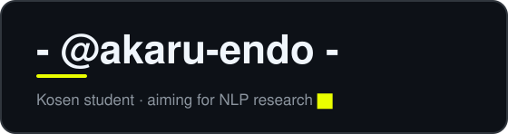

### T E C H &nbsp; S T A C K

<table>
  <tr>
    <td align="right"><b>LANGUAGES</b></td>
    <td>
      
      
      
      
      
      
    </td>
  </tr>
  <tr>
    <td align="right"><b>DATA & ML</b></td>
    <td>
      
      
      
      
    </td>
  </tr>
  <tr>
    <td align="right"><b>TOOLS</b></td>
    <td>
      
      
      
      
      
      
    </td>
  </tr>
</table>

### S T A T S

<picture>
  <source media="(prefers-color-scheme: dark)" srcset="https://streak-stats.demolab.com?user=akaru-endo&hide_border=true&background=0D1117&ring=EAFF00&fire=EAFF00&currStreakNum=FFFFFF&currStreakLabel=EAFF00&sideNums=FFFFFF&sideLabels=9E9E9E&dates=6E7681&stroke=30363D" />
  <source media="(prefers-color-scheme: light)" srcset="https://streak-stats.demolab.com?user=akaru-endo&hide_border=true&background=FFFFFF&ring=C7B300&fire=C7B300&currStreakNum=0D1117&currStreakLabel=9A8A00&sideNums=0D1117&sideLabels=57606A&dates=6E7681&stroke=D0D7DE" />
  
</picture>

### C O N T R I B U T I O N S

<picture>
  <source media="(prefers-color-scheme: dark)" srcset="https://raw.githubusercontent.com/akaru-endo/akaru-endo/output/github-snake-dark.svg" />
  <source media="(prefers-color-scheme: light)" srcset="https://raw.githubusercontent.com/akaru-endo/akaru-endo/output/github-snake.svg" />
  
</picture>

Predicting the next token, one commit at a time.

