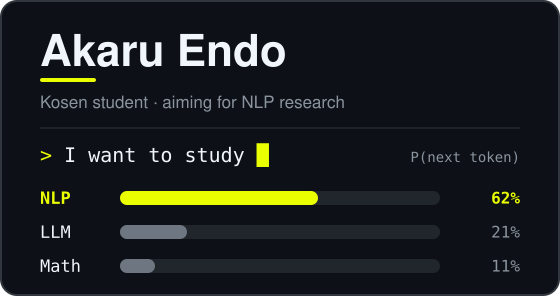

# - @akaru-endo -

### Learning Algorithms & Data Structures

<!-- ============ ここから下がリデザイン ============ -->

### A B O U T

<table>
  <tr><td align="right"><b>STATUS</b></td><td>&nbsp;Kosen Student · Control & Information Engineering</td></tr>
  <tr><td align="right"><b>NOW</b></td><td>&nbsp;C · Algorithms · Data Structures</td></tr>
  <tr><td align="right"><b>NEXT</b></td><td>&nbsp;Linear Algebra · Probability · NLP</td></tr>
  <tr><td align="right"><b>INTEREST</b></td><td>&nbsp;Tokenization · Embeddings · Transformer · LLM</td></tr>
  <tr><td align="right"><b>GOAL</b></td><td>&nbsp;Research in Natural Language Processing</td></tr>
</table>

### T E C H &nbsp; S T A C K

### R O A D M A P

### S T A T S

<picture>
  <source media="(prefers-color-scheme: dark)" srcset="https://streak-stats.demolab.com?user=akaru-endo&hide_border=true&background=0D1117&ring=FFFFFF&fire=FFFFFF&currStreakNum=FFFFFF&currStreakLabel=FFFFFF&sideNums=9E9E9E&sideLabels=9E9E9E&dates=6E7681" />
  <source media="(prefers-color-scheme: light)" srcset="https://streak-stats.demolab.com?user=akaru-endo&hide_border=true&background=FFFFFF&ring=000000&fire=000000&currStreakNum=000000&currStreakLabel=000000&sideNums=57606A&sideLabels=57606A&dates=6E7681" />
  
</picture>

### C O N T R I B U T I O N S

<picture>
  <source media="(prefers-color-scheme: dark)" srcset="https://raw.githubusercontent.com/akaru-endo/akaru-endo/output/github-snake-dark.svg" />
  <source media="(prefers-color-scheme: light)" srcset="https://raw.githubusercontent.com/akaru-endo/akaru-endo/output/github-snake.svg" />
  
</picture>

&nbsp;

